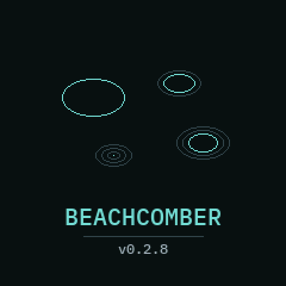
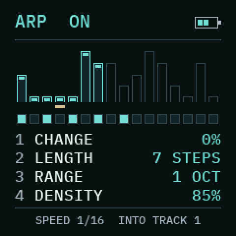
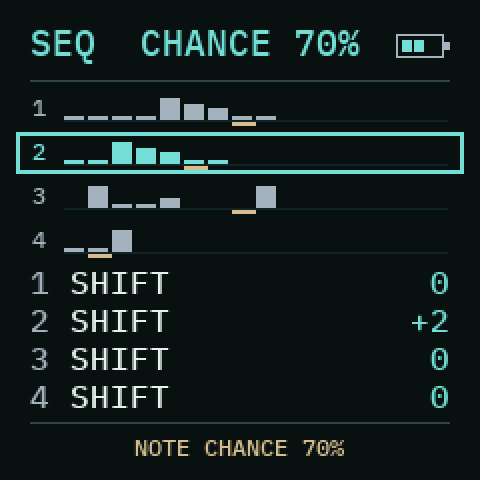
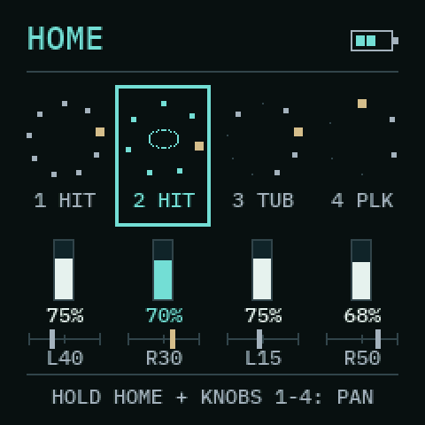

# BEACHCOMBER

  
  

  
  

> [!WARNING]
> **Not tested on a real FM‑1 yet.** BEACHCOMBER has only been tested on a computer and in the online FM‑1 emulator. Install it on your FM‑1 at your own risk, and keep the stock firmware or another firmware ready to flash back.

BEACHCOMBER is a firmware for the **M‑VAVE FM‑1**. A random arpeggiator washes
melodies up like the sea; you pick up the ones you like and keep them on four tracks
that loop, each at its own length. Turn the ARP off and listen to what you collected.

The idea is an instrument for the moment. The ARP is a loop of sixteen dice that you
can lock, let drift or throw again. **REC** keeps what it plays, **PUNCH IN** replaces
part of it, and the scale comes last, so every recording follows a new scale or key
straight away. Nothing is saved: press **SAVE** and the FM‑1 tells you why.

- **ARP: sixteen dice**, inspired by the Turing Machine and Marbles: CHANGE (locked to always new), LENGTH, RANGE and DENSITY; the white keys choose the notes it may use.
- **SEQ: four tracks** of up to 16 steps, each its own length and speed. Record, punch in, mute, and SHIFT a track up or down the scale for instant harmony; **NOTE CHANCE** thins all the tracks out.
- **The scale comes last**: 43 scales, common and exotic, a random one at every power‑on. The keys transpose everything, recordings included. No wrong notes.
- **PLUCK, BLOW, HIT and TUBE**, four ringing engines, each excited by a **ping**: noise, waves, or (PLUCK and TUBE) a whole chord on one voice. HIT is the drum. All equally loud, a random sound on every track at power‑on.
- **Delay, hall and chorus in parallel**, an envelope and an LFO per track, a mixer with volume and pan, MIDI in and out with clock.
- **Every button does what it says**, one page each, no menus inside menus.

[Read the operator manual](docs/OPERATOR-MANUAL.md) · [Build and test](docs/BUILDING.md) · [Credits and licenses](LICENSING.md)

**Version 0.2.8** builds as `beachcomber_0.2.8.fwsc`. The host tests and the
simulated installer checks passed, and it plays in the online FM‑1 emulator. It has
**not yet been installed on a physical FM‑1**.

## Credits

BEACHCOMBER builds on [Dinghy](https://github.com/zvenson/dinghy) by zvenson and the
[Felucca](https://github.com/hugelton/Felucca) and [SLOOP](https://github.com/isod89/sloop-fm1)
platform work it carries, and on the sound engine, delay and hall of
[LOOPHEADS](https://github.com/jaak-stjaaques/LOOPHEADS-public). The engines follow the
[Karplus–Strong method](https://doi.org/10.2307/3680062) of Kevin Karplus and Alex Strong,
string and drum. The ARP is inspired by the Music Thing Modular Turing Machine (Tom Whitwell)
and Mutable Instruments Marbles (Émilie Gillet); no code from either is used. The screen font is
[IBM Plex Mono](https://github.com/IBM/plex).

The firmware is distributed under [GPL-3.0-only](LICENSE). The
[full credits](LICENSING.md) retain the upstream notices and list the separately
licensed assets.
