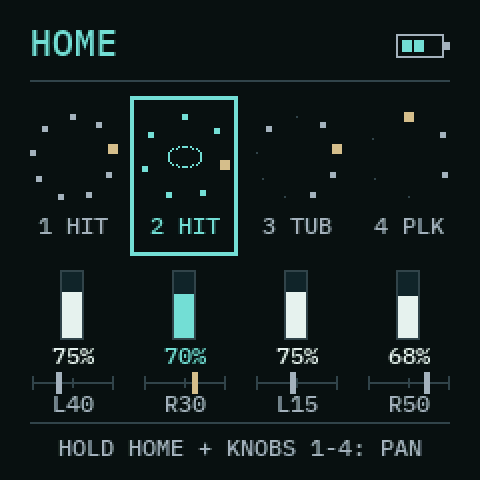
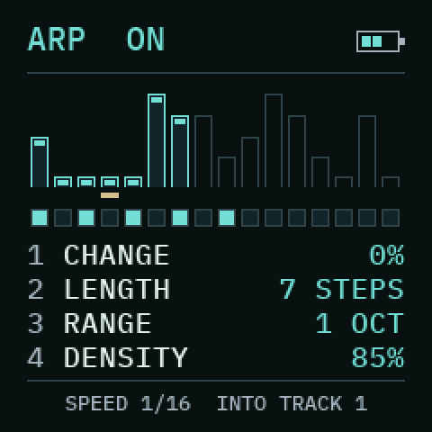
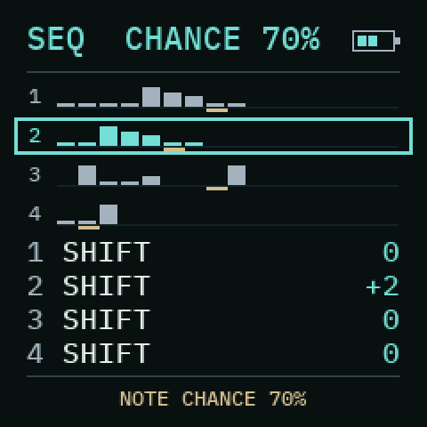
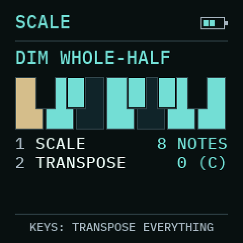
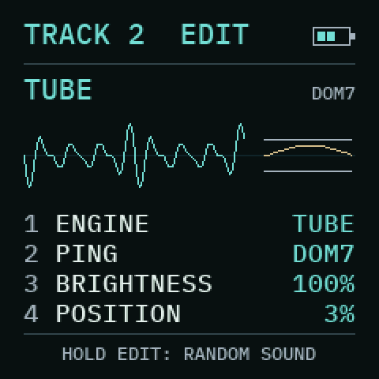
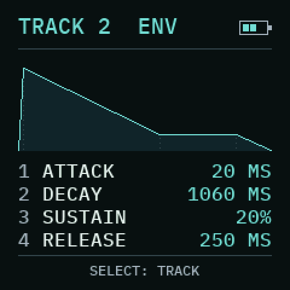
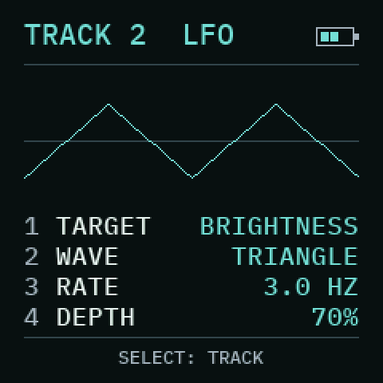
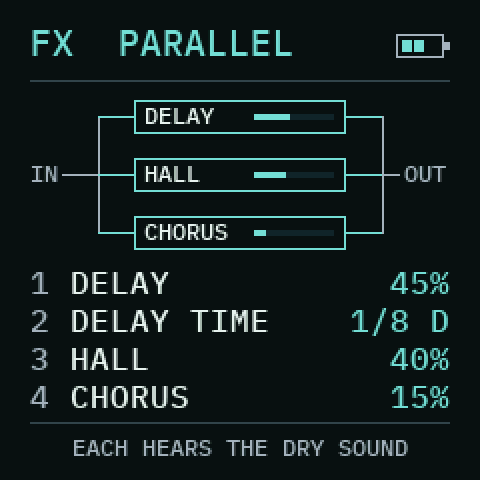
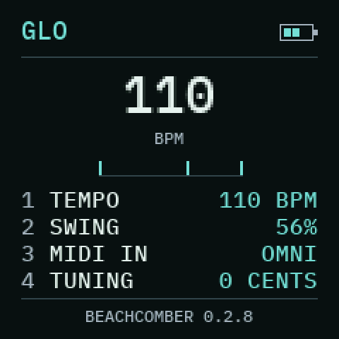
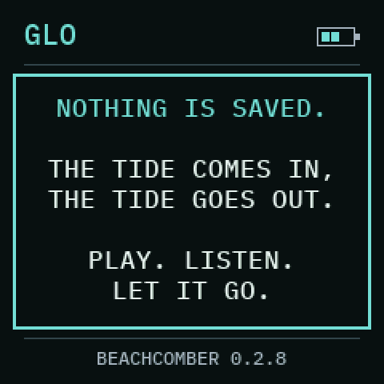

# BEACHCOMBER operator manual

For **BEACHCOMBER 0.2.8** on the **M‑VAVE FM‑1**.

> [!WARNING]
> **Not tested on a real FM‑1 yet.** BEACHCOMBER has only been tested on a computer and in the online FM‑1 emulator. Install it on your FM‑1 at your own risk, and keep the stock firmware or another firmware ready to flash back.

A random arpeggiator washes melodies up like the sea; you pick up the ones you like and keep them on four
tracks that loop, each at its own length. Turn the ARP off and listen to what you collected.

```
ARP (16 dice)  ->  SEQ (4 tracks)  ->  SCALE  ->  PLUCK / BLOW / HIT / TUBE  ->  DELAY + HALL + CHORUS
```

The ARP and the tracks only know *steps of a scale*, not notes. The scale comes last and turns steps into
notes, so **change the scale or the key and everything follows, your recordings too. There are no wrong
notes.**

Every labelled button does what its label says. Only two have new jobs: **SEL** opens the **SCALE** page, and
**HOME** is the mixer. Nothing is saved: every power‑on starts with empty tracks, a random sound on every
track and a random scale.

## Play in a browser

Open the [FM‑1 emulator](https://joakimeriksson.github.io/fm1-emu/) in Chrome, click **Open .fwsc…**, choose
`beachcomber_0.2.8.fwsc` (or drop the file on the synth) and press **Start** to enable audio.

## Install

Download `beachcomber_0.2.8.fwsc` from the [releases](https://github.com/jaak-stjaaques/Beachcomber/releases)
and install it with the M‑VAVE updater or [M‑Flasher](https://github.com/jvitkauskas/m-flasher) like any other
FM‑1 firmware (leave the bootloader option unchecked). Make a full backup first. If it ever fails to start,
hold **OCT−** while switching on: the FM‑1 starts in its USB rescue, where any firmware can be installed.

## Collect your first tracks

1. Turn up **MASTER** and press **PLAY**. The ARP starts playing through track 1.
2. Press **ARP** to see its sixteen dice. Turn knob 1, **CHANGE**, to 0%: the melody locks and repeats. Knob 2,
   **LENGTH**, makes the loop shorter or longer. Hold **ARP** to throw all the dice again.
3. Press **REC**. Recording starts with the ARP's next step. Press **REC** again: the track loops what you
   heard, and the ARP stops, so you hear only the track.
4. Turn **SELECT** to track 2 and press **REC** again: the ARP comes back where it left off. Change the speed
   with the **PRESETS** encoder first for a slower or faster line.
5. Press **SEQ** to see the four tracks, and **SEL** to change the scale under all of them.

Hold **REC** to clear the selected track. Press **PLAY** again to stop everything.

## The screen

Every page has the same layout: the title and the battery at the top, a picture in the middle, the four knobs
at the bottom, numbered **1–4** like the knobs on the FM‑1, and a hint on the last line. The selected track
(1–4, chosen with **SELECT**) is the one EDIT, ENV and LFO change, the one the ARP plays through and the one REC
records into.

<p align="center">
  
  
  
</p>
<p align="center">
  
  
  
</p>
<p align="center">
  
  
  
</p>

## The panel

| Control | What it does |
| --- | --- |
| **HOME** | The mixer: four tide pools and a fader and pan under each. |
| **ARP** | The ARP page. **Press ARP again** on its page: ARP on / off. **Hold ARP**: throw all the dice again. |
| **SEQ** | The four tracks. |
| **SEL** | The SCALE page. |
| **EDIT** | The selected track's sound. **Hold EDIT**: a random sound. |
| **ENV** | The selected track's envelope. |
| **LFO** | The selected track's LFO. |
| **FX** | Delay, hall and chorus, in parallel. |
| **GLO** | Tempo, swing, MIDI, tuning. |
| **PLAY/STOP** | Start or stop everything, the ARP and the tracks. |
| **REC** | Record the ARP into the selected track; on a track with notes, **punch in**. Press again to stop. **Hold REC**: clear the selected track. |
| **SAVE** | Saves nothing (see [SAVE](#save)). |
| **OCT− / OCT+** | The ARP and the keyboard an octave down or up (−2 … +2). Not the tracks: a recorded track keeps the octave it was recorded at. |
| **SELECT** (encoder) | Choose the track, 1–4. |
| **ALGORITHM** (encoder) | **NOTE CHANCE**, on any page: the chance that each recorded note plays, all four tracks, 0% to 100% in steps of 5 (100% at power‑on). The notes themselves are kept. |
| **PRESETS** (encoder) | The ARP's speed, on any page: 1/2, 1/4, 1/4 T, 1/8, 1/8 T, 1/16, 1/16 T, 1/32, 1/32 T. A new recording takes this speed. |
| **Hold HOME + knobs 1–4** | The pan of tracks 1–4, on any page. |

## HOME: the mixer

Four tide pools, one for each track: its steps in a ring, the one playing in sand, the selected track in a box.
Under each pool, its mixer: a **fader** (the volume, with its %) and a **balance** line with the pan under it
(C, L40, R100…).

| Knob | |
| --- | --- |
| 1–4 | The volume of tracks 1–4 (75% at power‑on). |
| **Hold HOME** + 1–4 | The pan of tracks 1–4, in steps of 5 (centre at power‑on). |

The keys play the selected track.

## ARP: sixteen dice

The ARP is a loop of up to 16 slots. Each slot holds two dice: **which note**, and **whether it plays**. Every
step the loop moves on one slot, and sometimes the slot's dice are thrown again. On the screen each column is a
slot: its height is the note, a filled column plays, an empty one is silent, the sand mark is the slot playing
now. The squares under the columns are the note pool.

| Knob | | |
| --- | --- | --- |
| 1 | **CHANGE** | How often a slot gets new dice. 0% = locked, the loop repeats for ever. 100% = always new. In between, the melody changes a little at a time. |
| 2 | **LENGTH** | 1 to 16 steps in the loop. |
| 3 | **RANGE** | 1 to 4 octaves for the notes. |
| 4 | **DENSITY** | How many slots play. 100% = all of them, lower = more silences: a rhythm. |

- **White keys: the note pool.** Tap a white key to light it, tap again to turn it off. The ARP picks only from
  the lit notes. The lowest white key is the first step of the scale (the root), the next one the second step,
  and so on, 16 steps in all. With nothing lit, the ARP uses the whole scale.
- **Black keys:** nothing on this page.
- **The speed** is on the **PRESETS** encoder; the hint line shows it.
- **ARP, ARP** turns the ARP on and off. **Hold ARP** throws all the dice again.

Every power‑on starts with a new melody: the dice are thrown again the moment you first touch a button or a key.

Tips: lock the loop (CHANGE 0%) when you hear something you like, then record it. Let it drift (CHANGE 10–30%)
for a melody that keeps changing slowly.

## SEQ: four tracks

| | |
| --- | --- |
| **REC** on an empty track | Records the ARP from its next step, step by step, until you press REC again (16 steps at most). The track then loops at that length, at the ARP's speed, and **the ARP stops**: now you hear only the tracks. |
| **REC** on a track with notes | **PUNCH IN**, as on tape. The track keeps its length and keeps running; every step it passes over is replaced by what the ARP plays there, silences too, and you hear only the new notes. Press REC again to **punch out**: the old notes after that point play on at once, with no gap (the ARP stops). Punch in for longer than a loop and the second pass replaces the first. |
| **REC** with the ARP off | Turns the ARP back on (its dice where they were left) and records. |
| **Hold REC** | Clears the selected track. |
| **Knobs 1–4** | **SHIFT** tracks 1–4 up or down by notes of the scale (−12 … +12). Record the same melody on two tracks, shift one by +2: a harmony, always in the scale. |
| **White keys 1–4** (lowest) | Mute / unmute tracks 1–4 (lit = playing). |
| **White keys 5–8** | Select track 1–4. |

The selected track has a box around it (red while it records); the title shows the NOTE CHANCE. The tracks keep
their own lengths: a 7‑step track against a 5‑step track drifts out of step and back. Each track plays its own
sound, chosen after the recording: EDIT, ENV and LFO change a recorded track at any time.

## SCALE (the SEL button)

| | |
| --- | --- |
| **The keyboard** | Transposes everything. The 8th key from the left (C4) means no transposition; each key to the right is a semitone up, to the left a semitone down. The lit key is the transposition now. With OCT+ the keys reach an octave higher, with OCT− an octave lower. |
| Knob 1 | **SCALE**: 43 scales. At every power‑on a random one is chosen (any but Chromatic). |
| Knob 2 | **TRANSPOSE**, the same as the keys (0 (C) at power‑on). |

The picture shows the scale on a piano octave, the root in sand.

**The scales:** Chromatic, Major, Minor, Major Pent, Minor Pent, Blues, Major Blues, Harmonic Minor, Melodic
Minor, Dorian, Phrygian, Lydian, Mixolydian, Locrian, Lydian Dominant, Bebop Dominant, Bebop Major, Altered,
Whole Tone, Dim Half‑Whole, Dim Whole‑Half, Augmented, Hirajoshi, In Sen, Iwato, Kumoi, Yo, Pelog, Egyptian,
Hijaz, Double Harmonic (also known as Raga Bhairav), Hungarian Minor, Hungarian Major, Ukrainian Dorian,
Persian, Oriental, Neapolitan Minor, Neapolitan Major, Enigmatic, Prometheus, Spanish 8‑Tone, Raga Todi,
Raga Marwa. (Pelog is the nearest piano‑key version; the real one sits between the keys.)

## EDIT: the sound of the selected track

Four engines, each a delay line that rings when something hits it:

- **PLUCK**: a plucked string.
- **BLOW**: a reed blowing into a tube: hollow, breathy, it can sustain.
- **HIT**: a struck skin: the string with a coin toss on every trip, so the pitch blurs into a drum. Low notes
  are toms and kicks, high ones snaps and ticks. **HIT is BEACHCOMBER's drum engine.**
- **TUBE**: a tube struck or plucked, without the breath: hollow, woody, clarinet‑like.

The **PING** is what hits the engine: White Noise, Pink Noise, Brown Noise, Sine, Triangle, Saw, Square, and, for
**PLUCK and TUBE**, the chords **Major, Minor, Sus2, Sus4, Fifth, Maj7, Min7, Dom7**. A chord ping fills one delay
line with all the notes of the chord, so **a chord costs one voice, not three or four**. (Dom7 uses the natural
seventh, a little lower and sweeter than the piano's.) BLOW and HIT stop at Square; a chord sound switched to them
gets white noise.

| Knob | |
| --- | --- |
| 1 | **ENGINE** |
| 2 | **PING** |
| 3 | **BRIGHTNESS**: dark to bright |
| 4 | **POSITION**: where the ping hits, the middle (round) or near the end (thin) |

**Hold EDIT** for a random sound. Every power‑on gives every track a random sound.

**All the same loudness.** Every engine with every ping, at any brightness and position, comes out about as loud
as the others (measured: nine in ten of all the combinations within ±3 dB; `tools/measure_levels.c`). Noise pings
vary a little from note to note, as noise does.

**Six voices.** BEACHCOMBER rings up to 6 notes at once (tracks, ARP and keys together); a 7th takes the voice of
the oldest one. A voice that has rung out is freed at once.

## ENV and LFO

**ENV** (selected track): 1 ATTACK, 2 DECAY, 3 SUSTAIN, 4 RELEASE (up to 2 s).

**LFO** (selected track): 1 TARGET (pitch, volume, brightness, position), 2 WAVE (sine, triangle, square, saw,
random), 3 RATE (0.1 to 12 Hz), 4 DEPTH.

## FX: in parallel

Delay, hall and chorus each hear the dry sound on their own; none feeds another. The dry sound always passes.

| Knob | |
| --- | --- |
| 1 | **DELAY** amount |
| 2 | **DELAY TIME**: 1/16, 1/8, 1/8 D, 1/4, 1/4 D (follows the tempo) |
| 3 | **HALL** amount (12‑bit, 10 kHz inside: a soft, dark room) |
| 4 | **CHORUS** amount |

## GLO

1 **TEMPO** (40–240 BPM), 2 **SWING** (straight to 75%: every second step late), 3 **MIDI IN** channel (OMNI or
1–16), 4 **TUNING** (±50 cents).

**MIDI:** a MIDI clock in (USB or the TRS jack) sets the tempo by itself; START and STOP start and stop
BEACHCOMBER. Notes in play the selected track, snapped to the scale. Out: tracks 1–4 send on channels 1–4, the
ARP and the keys on the selected track's channel.

## SAVE

BEACHCOMBER keeps nothing between power‑ons. **SAVE** shows one of five little notes about that, at random,
never the same twice in a row:

<p align="center"></p>

Any button, key or knob puts the page back.

## Playing the keys

On HOME, EDIT, ENV, LFO, FX and GLO the keys play the selected track, snapped to the scale, transposed with
everything else and moved by OCT− / OCT+.
